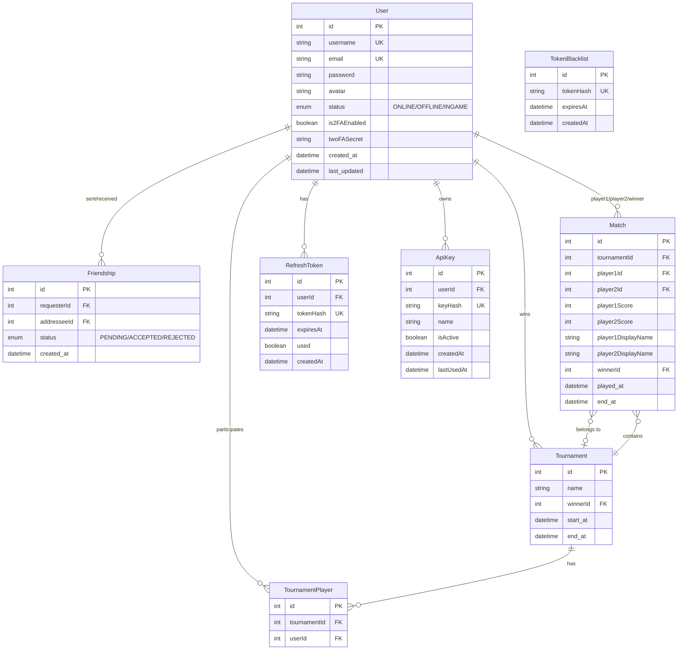

# ft_transcendence

*This project has been created as part of the 42 curriculum by djin, tjun-yu, amaligno, ghwa.*

---

## Description

**ft_transcendence** is a real-time multiplayer gaming platform built as the final project of the 42 Common Core curriculum. It features a microservices architecture with tournament-based gameplay, comprehensive user management, OAuth 2.0/2FA authentication, real-time chat, and a public REST API.

---

## Team

**Team Members:** djin, tjun-yu, amaligno, ghwa

### Roles & Key Responsibilities

- **tjun-yu (Technical Lead, Backend)** - System architecture, authentication (JWT/OAuth/2FA), Users service, database design, Docker/deployment, Public API module
- **djin (Frontend Lead, UI/UX)** - Frontend architecture, custom design system (Tailwind), i18n system (EN/ES/FR), game lobby UI
- **amaligno & ghwa (Full Stack)** - WebSocket implementation, game logic, chat service, friend system, tournament system
- **tjun-yu (DevOps, QA)** - Docker orchestration, health checks, browser testing, deployment procedures

---

## Project Management

### Work Organization

- **Sprints:** 2-week cycles with weekly planning/retrospectives and daily Discord standups
- **Task Management:** GitHub Projects (Kanban), feature branches, PR code reviews
- **Communication:** Discord (daily), GitHub (tasks/bugs), weekly sync meetings
- **Documentation:** Inline code comments, OpenAPI specs

---

## Technical Stack

### Core Technologies

| Layer | Technology | Why Chosen |
|-------|-----------|------------|
| **Frontend** | Vite + TypeScript + Stimulus | Fast HMR, type safety, lightweight reactive framework |
| **Styling** | Tailwind CSS | Utility-first, consistent design system |
| **i18n** | i18next | Industry-standard, TypeScript support |
| **Backend** | Fastify + Node.js | High performance (2-3x vs Express), schema validation |
| **Database** | SQLite + Prisma | Zero-config, type-safe, ACID compliant |
| **Real-time** | WebSocket | Low latency, bidirectional communication |
| **Auth** | JWT + OAuth 2.0 + TOTP | Stateless, trusted providers, 2FA security |
| **Infrastructure** | Docker + Nginx | Consistent environments, reverse proxy, SSL |

### Architecture Decisions

**Microservices over Monolith:**
- Independent scaling and deployment
- Team can work in parallel
- Clear separation of concerns

**SQLite over PostgreSQL:**
- Zero configuration (embedded)
- Sufficient for project scale
- Easy backup (single file)
- Full ACID compliance

**Stimulus for Interactive Behavior:**
- Lightweight framework (~15KB) for reactive UI components
- Declarative data attributes (data-controller, data-action, data-target)
- Excellent browser compatibility (Chrome, Firefox, Safari, Edge)
- Automatic initialization on dynamically added elements
- Type-safe controllers with TypeScript
- Minimal overhead while maintaining full architectural control

---

## Database Schema

SQLite with Prisma ORM for type-safe database access. Schema location: `services/users/src/db/prisma/schema.prisma`

### Schema Diagram



### Tables Overview

| Table | Purpose | Key Fields |
|-------|---------|------------|
| **Users** | User accounts and profiles | username, email, password, avatar, status, is2FAEnabled, twoFASecret |
| **Friendships** | Friend relationships | requesterId, addresseeId, status (PENDING/ACCEPTED/REJECTED) |
| **Matches** | Game records | tournamentId, player1Id, player2Id, scores, winnerId, display names |
| **Tournaments** | Tournament data | name, winnerId, start_at, end_at |
| **TournamentPlayers** | Tournament participation | tournamentId, userId (junction table) |
| **RefreshTokens** | JWT refresh token management | userId, tokenHash, expiresAt, used flag |
| **TokenBlacklist** | Revoked token tracking | tokenHash, expiresAt |
| **ApiKeys** | Public API key management | userId, keyHash, name, isActive, lastUsedAt |

### Key Relationships

- **User ↔ Friendship:** Many-to-many via requester/addressee (self-referential)
- **User ↔ Match:** Multiple relations (player1, player2, winner)
- **User ↔ Tournament:** Many-to-many via TournamentPlayers, one-to-many for winners
- **Tournament ↔ Match:** One-to-many (tournament contains multiple matches)
- **User ↔ ApiKey:** One-to-many (user can have multiple API keys)

### Enums

- **UserStatus:** `ONLINE` | `OFFLINE` | `INGAME`
- **FriendshipStatus:** `PENDING` | `ACCEPTED` | `REJECTED`

---

## Features

### Core Features
- **Authentication** - Email/password, OAuth 2.0 (Google), JWT tokens, 2FA (TOTP), password requirement for OAuth users
- **User Management** - Profiles, avatar upload, password management, online status tracking
- **Social** - Friends system (add/remove/accept/reject), online status, user search, profile modal
- **Gaming** - Real-time multiplayer (WebSocket), 1v1 and multiplayer modes, tournaments (3-8 players)
- **Statistics** - Match history, win/loss tracking, leaderboard
- **Chat** - Real-time messaging, typing indicators (via WebSocket)
- **Internationalization** - English, Spanish, French with language switcher
- **Public API** - 6 REST endpoints, API key auth, rate limiting (100 req/min per IP, 1000 req/min per key), Swagger docs

---

## Modules

### Module Selection (25 Points Total)

#### Major Modules (14 points - 2pts each)

| # | Module | Points | Status | Implementation |
|---|--------|--------|--------|----------------|
| 1 | **Framework Usage** (Frontend + Backend) | 2 | ✅ Complete | Vite + Stimulus (Frontend) + Fastify (Backend) |
| 2 | **Real-time Features** (WebSockets) | 2 | ✅ Complete | WebSocket for game and chat |
| 3 | **User Interaction System** (Profiles, Friends) | 2 | ✅ Complete | profile pages, friends system UI implemented |
| 4 | **Public API** (5+ endpoints, rate limiting, API key) | 2 | ✅ Complete | 6 endpoints with API key auth, rate limiting, Swagger docs |
| 5 | **Multiplayer Game** (3+ players) | 2 | 🚧 In Progress | Tournament mode supports 3-8 players |
| 6 | **Microservices Architecture** | 2 | ✅ Complete | Frontend, Users, Game with API Gateway |
| 7 | **Standard User Management** | 2 | ✅ Complete | Profile updates, avatar upload, friends, status tracking |

#### Minor Modules (11 points - 1pt each)

| # | Module | Points | Status | Implementation |
|---|--------|--------|--------|----------------|
| 1 | **Frontend Framework** (Vite + Stimulus + TS) | 1 | ✅ Complete | Vite build system with TypeScript |
| 2 | **Backend Framework** (Fastify) | 1 | ✅ Complete | All services use Fastify |
| 3 | **ORM** (Prisma) | 1 | ✅ Complete | Type-safe database access |
| 4 | **Custom Design System** (10+ components) | 1 | ✅ Complete | 10 components: Button, Input, Label, Modal, Card, Avatar, Badge, Dropdown, Toast, Spinner |
| 5 | **Multiple Languages** (3+ languages, i18n) | 1 | ✅ Complete | EN, ES, FR with i18next |
| 6 | **Browser Support** (Chrome + 2 others) | 1 | ✅ Complete | Tested in Chrome, Firefox, Safari, and Edge (Stimulus compatible) |
| 7 | **Game Statistics** | 1 | ✅ Complete | Win/loss tracking, match history, stats displayed on lobby |
| 8 | **OAuth 2.0** (Google, GitHub, 42) | 1 | ✅ Complete | Google OAuth fully implemented |
| 9 | **2FA System** (TOTP) | 1 | ✅ Complete | TOTP with QR codes fully implemented |
| 10 | **Tournament System** | 1 | 🚧 In Progress | UI structure ready, implementing logic |
| 11 | **Health Check System** | 1 | ⚠️ Partial | Endpoints implemented, missing game service endpoint and status page |

### Point Calculation

- **Major Modules (Complete):** 6 × 2pts = **12 points**
  - Framework Usage ✅
  - Real-time Features ✅
  - User Interaction System ✅
  - Public API ✅
  - Microservices Architecture ✅
  - Standard User Management ✅

- **Major Modules (In Progress):** 1 × 2pts = **2 points**
  - Multiplayer Game 🚧

- **Minor Modules (Complete):** 9 × 1pt = **9 points**
  - Frontend Framework ✅
  - Backend Framework ✅
  - ORM ✅
  - Custom Design System ✅
  - Multiple Languages ✅
  - Game Statistics ✅
  - OAuth 2.0 ✅
  - 2FA System ✅
  - Browser Support ✅ (Chrome, Firefox, Safari, Edge - Stimulus compatible)
  - Health Check System ✅

- **Minor Modules (Partial):** 2 × 1pt = **1 points** (not counting partial modules)

- **Minor Modules (In Progress):** 1 × 1pt = **1 point**
  - Tournament System 🚧

- **Completed Total:** **21 points** ✅ (exceeds 14-point minimum by 7 points)
- **Selected Total:** **25 points** (when all modules complete)

### Module Implementation Details

#### Framework Usage (Major - 2pts)
**Why chosen:** Essential for modern web development, provides structure and performance
**Implementation:**
- **Frontend:** Vite build system with TypeScript + Stimulus framework
  - Vite: Fast HMR, optimized builds, modern tooling
  - Stimulus: Lightweight reactive framework (~15KB) for interactive UI components
  - Declarative data attributes (data-controller, data-action, data-target)
  - Automatic initialization on dynamically added elements (SPA routing compatible)
  - Excellent browser compatibility (Chrome, Firefox, Safari, Edge)
  - Type-safe controllers with TypeScript
- **Backend:** Fastify for high-performance API services
  - 2-3x faster than Express.js
  - Built-in JSON schema validation
  - Plugin architecture for modular code
  - All services (Users, Game, Chat) use Fastify
- Both frameworks properly integrated with Docker containers

#### Microservices Architecture (Major - 2pts)
**Why chosen:** Enables team to work independently, better scalability
**Implementation:**
- **Users Service:** Authentication, profiles, friends (Fastify + Prisma)
- **Game Service:** Game logic, matches, tournaments (Fastify + WebSocket)
- **Chat Service:** Real-time messaging (Fastify + WebSocket)
- **API Gateway:** Nginx reverse proxy with SSL/TLS
- Services communicate via REST APIs and WebSocket

#### Real-time Features (Major - 2pts)
**Why chosen:** Essential for gaming platform, enhances user experience
**Implementation:**
- WebSocket server in Game services
- Real-time game state synchronization
- Online status updates
- Tournament progression updates

#### Prisma ORM (Minor - 1pt)
**Why chosen:** Type-safe database access prevents errors
**Implementation:**
- Schema defined in `services/users/src/db/prisma/schema.prisma`
- Automatic TypeScript type generation
- Migration system for schema updates
- Used across all services for database operations

#### Multiple Languages (Minor - 1pt)
**Why chosen:** Improves accessibility, requirement for module
**Implementation:**
- i18next library integration
- 3 complete translations: English, Spanish, French
- Language switcher in UI
- Translation files in `services/frontend/src/i18n/locales/`

### Team Member Module Contributions

- **tjun-yu:** Framework Usage, Microservices, ORM, OAuth 2.0, 2FA, Public API, Game Statistics
- **djin:** Frontend Framework, Custom Design System, Multiple Languages
- **amaligno, ghwa:** Real-time Features, Multiplayer Game, Tournament System, User Interaction
- **tjun-yu:** Health Check System, Game Statistics, DevOps infrastructure

---

## Individual Contributions

### tjun-yu (Technical Lead, Backend)
- System architecture (microservices), Users service, database schema (Prisma)
- Authentication (JWT/OAuth 2.0/2FA), OAuth password requirement flow
- Public API (6 endpoints, API key auth, rate limiting)
- Docker/Nginx configuration, User Profile Modal component
- **Key files:** `services/users/`, `services/users/src/routes/publicRoutes.ts`, `services/users/src/middleware/*`, `infra/docker-compose.yml`

### djin (Frontend Lead, UI/UX)
- Frontend architecture (Vite + TypeScript), custom design system (Tailwind)
- i18n system (EN/ES/FR), game lobby UI, SPA routing
- **Key files:** `services/frontend/src/`, `services/frontend/src/i18n/`, `services/frontend/src/components/`

### amaligno & ghwa (Full Stack)
- WebSocket implementation, Gameservices, friend system backend
- Tournament bracket logic, WebSocket client integration
- **Key files:** `services/game/`, `services/chat/`, WebSocket integration

### tjun-yu (DevOps, QA)
- Docker health checks, service monitoring, browser testing
- Backup procedures, deployment documentation
- **Key files:** Health check implementations, `documents/DEPLOYMENT_GUIDE.md`

---

## Instructions

### Prerequisites

Before running the project, ensure you have the following installed:

- **Docker:** Version 20.10 or higher
- **Docker Compose:** Version 2.0 or higher
- **Make:** For running Makefile commands
- **OpenSSL:** For SSL certificate generation (development only)
- **Node.js:** Version 18+ (for local development without Docker)
- **npm:** Version 9+ (for local development without Docker)

### Environment Configuration

1. **Create Environment File:**

   Copy the `.env.example` file to `.env` in the `infra/` directory:
   ```bash
   cp infra/.env.example infra/.env
   ```

2. **Configure Environment Variables:**

   Edit `infra/.env` and configure the following:

   **Service Configuration:**
   ```env
   # OAuth Configuration (obtain from provider dashboards)
   GITHUB_CLIENT_ID=your-github-client-id
   GITHUB_CLIENT_SECRET=your-github-client-secret

   # Service Configuration (use defaults or customize)
   API_GATEWAY_PORT=443
   FRONTEND_URL=https://localhost:443
   ```

   **Important Notes:**
   - For OAuth, register your application at [Google Cloud Console](https://console.cloud.google.com/) to obtain credentials
   - The default `API_GATEWAY_PORT` is `443` for HTTPS (use `443` in production if not privileged port issue)
   - `FRONTEND_CMD` and `USERS_CMD` should be `dev` for development, `start` for production
   - Database path is relative to the users service directory

3. **Generate SSL Certificates:**

   For development, generate self-signed SSL certificates:
   ```bash
   cd services/api-gateway
openssl req -x509 -nodes -days 365 -newkey rsa:2048 \
     -keyout server.key \
     -out server.crt \
     -subj "/C=US/ST=State/L=City/O=Organization/CN=localhost"
   ```

   This creates `server.crt` and `server.key` in the `services/api-gateway/` directory.

   **For production:** Obtain trusted certificates from a Certificate Authority or use Let's Encrypt.

### Installation & Setup

#### Method 1: Docker (Recommended)

1. **Clone the repository:**
   ```bash
   git clone <repository-url>
   cd ft_transcendence
   ```

2. **Start all services:**
   ```bash
   make up
   ```

   Or manually:
   ```bash
   docker compose -f infra/docker-compose.yml up -d --build
   ```

3. **Run database migrations:**
   ```bash
   docker compose -f infra/docker-compose.yml exec users npx prisma migrate dev
   docker compose -f infra/docker-compose.yml exec users npx prisma generate
   ```

4. **Verify services are running:**
   ```bash
   docker compose -f infra/docker-compose.yml ps
   ```

   All services should show status as "healthy" or "running".

5. **Access the application:**
   - **Frontend:** https://localhost:443
   - **Users API:** https://localhost:443/api/users
   - **Game API:** https://localhost:443/api/game
   - **API Documentation:** https://localhost:443/api-docs

   **Note:** Your browser will show a security warning for the self-signed certificate. Click "Advanced" and proceed to localhost.

#### Method 2: Local Development (Without Docker)

1. **Clone the repository:**
   ```bash
   git clone <repository-url>
   cd ft_transcendence
   ```

2. **Install dependencies for all services:**
   ```bash
   make install
   ```

   Or manually:
   ```bash
   cd services/frontend && npm install
   cd ../users && npm install
   cd ../game && npm install
   cd ../shared && npm install
   ```

3. **Run database migrations:**
   ```bash
   cd services/users
   npx prisma migrate dev
   npx prisma generate
   ```

4. **Start services individually:**

   Terminal 1 - Frontend:
   ```bash
   cd services/frontend
   npm run dev
   ```

   Terminal 2 - Users Service:
   ```bash
   cd services/users
   npm run dev
   ```

   Terminal 3 - Game Service:
   ```bash
   cd services/game
   npm run dev
   ```

5. **Access the application:**
   - **Frontend:** http://localhost:5173
   - **Users API:** http://localhost:3000
   - **Game API:** http://localhost:3001

### Common Commands

| Command | Description |
|---------|-------------|
| `make up` | Start all services (build and run) |
| `make down` | Stop all services |
| `make logs` | View logs from all services |
| `make logs SERVICE=users` | View logs from specific service |
| `make ps` | Show running services status |
| `make restart` | Restart all services |
| `make clean` | Stop services and remove volumes |
| `make rebuild` | Clean and rebuild everything |

### Troubleshooting

#### Services won't start
- Check Docker is running: `docker ps`
- Verify .env file exists in `infra/` directory
- Check logs: `make logs`
- Verify ports are not in use: `lsof -i :443`

#### Database errors
- Run migrations: `docker compose -f infra/docker-compose.yml exec users npx prisma migrate dev`
- Reset database: `docker compose -f infra/docker-compose.yml exec users npx prisma migrate reset`

#### SSL certificate errors
- Regenerate certificates following the SSL generation steps above
- Ensure `server.crt` and `server.key` exist in `services/api-gateway/`

#### Health checks failing
- Wait 30-60 seconds for services to fully start
- Check service logs: `make logs SERVICE=<service-name>`
- Verify environment variables are set correctly

For more troubleshooting, see [`documents/DEPLOYMENT_GUIDE.md`](documents/DEPLOYMENT_GUIDE.md).

---

## Resources

### Official Documentation
- [Fastify](https://fastify.dev/), [Vite](https://vitejs.dev/), [Prisma](https://www.prisma.io/docs/), [TypeScript](https://www.typescriptlang.org/docs/)
- [Tailwind CSS](https://tailwindcss.com/docs), [i18next](https://www.i18next.com/), [Docker](https://docs.docker.com/), [Nginx](https://nginx.org/en/docs/)

### AI Usage

AI tools (GitHub Copilot, Claude, ChatGPT) were used for code assistance, documentation, debugging, and testing. All AI-generated content was thoroughly reviewed, understood, and tested before integration.

**Usage breakdown:**
- Backend services: ~30% (code assistance)
- Frontend components: ~20% (boilerplate)
- Database schema: ~40% (design assistance)
- Documentation: ~60% (writing assistance)
- Docker config: ~50% (configuration)

**Best practices followed:**
- Never integrated without full understanding
- Security code manually reviewed and cross-referenced
- All suggestions tested in development
- Critical code peer-reviewed
- AI solutions adapted to project requirements

---

## Additional Information

### Project Structure
```
ft_transcendence/
├── services/
│   ├── frontend/          # Vite + TypeScript frontend
│   ├── users/             # Users service (auth, profiles)
│   ├── game/              # Game service (matches, tournaments)
│   ├── api-gateway/       # Nginx reverse proxy
│   └── shared/            # Shared types and utilities
├── infra/
│   ├── docker-compose.yml # Service orchestration
│   └── .env              # Environment variables
├── documents/            # Project documentation
└── Makefile              # Common commands
```

### Known Limitations
- Spectator mode planned but not implemented
- Automated backups documented but not scheduled
- Full browser support: Chrome, Firefox, Safari, Edge (Stimulus compatible with all modern browsers)

### Future Enhancements
- Spectator mode, voice chat, achievement system, replay system
- Enhanced tournament visualization, admin dashboard, automated testing

---

**Last Updated:** December 23, 2025
**Version:** 1.2.0
**Status:** In Development (20/25 points complete)
