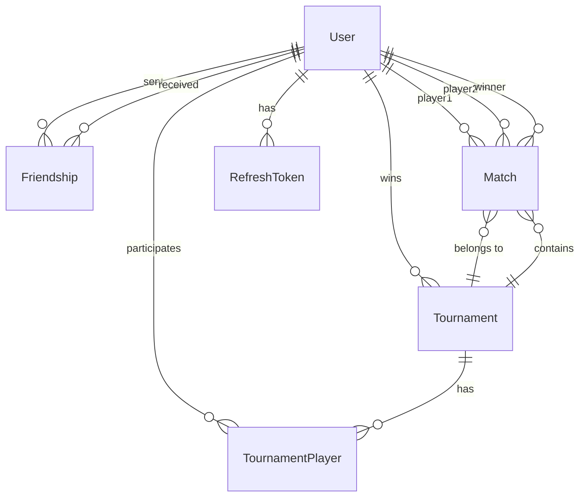

# ft_transcendence

*This project has been created as part of the 42 curriculum by imsolucas, [teammate2], [teammate3], [teammate4].*

---

## Description

**ft_transcendence** is a real-time multiplayer web application built as the final project of the 42 Common Core curriculum. The project showcases a microservices architecture implementing a tournament-based competitive gaming platform with comprehensive user management, real-time features, and modern web technologies.

### Project Name
**ft_transcendence - Real-time Tournament Gaming Platform**

### Key Features
- **Real-time Multiplayer Gaming** - WebSocket-powered gameplay for seamless real-time interaction
- **Tournament System** - Bracket-based tournaments supporting 3-8 players
- **User Management** - Complete authentication with OAuth 2.0 and 2FA support
- **Social Features** - Friends system, chat, and online status tracking
- **Internationalization** - Multi-language support (English, Spanish, French)
- **Microservices Architecture** - Scalable, loosely-coupled service design
- **Public API** - REST API with rate limiting and comprehensive documentation
- **Custom Design System** - Tailwind CSS-based component library

---

## Team Information

### Team Members

#### **imsolucas** (Team Member 1)
- **Roles:** Technical Lead, Backend Developer
- **Responsibilities:**
  - Overall technical architecture and system design
  - Backend service development (Users service, Game service)
  - Database schema design and implementation
  - Authentication system (JWT, OAuth 2.0, 2FA)
  - API development and documentation
  - Docker and deployment configuration

#### **[teammate2]** (Team Member 2)
- **Roles:** Frontend Lead, UI/UX Developer
- **Responsibilities:**
  - Frontend architecture and component design
  - UI/UX implementation with Tailwind CSS
  - Game lobby and tournament interfaces
  - Internationalization system (i18n)
  - Custom design system development
  - WebSocket client integration

#### **[teammate3]** (Team Member 3)
- **Roles:** Full Stack Developer
- **Responsibilities:**
  - Real-time features (WebSocket implementation)
  - Chat service development
  - Game logic and state management
  - Friend system and social features
  - Integration testing
  - Documentation

#### **[teammate4]** (Team Member 4)
- **Roles:** DevOps Engineer, QA
- **Responsibilities:**
  - Docker containerization and orchestration
  - CI/CD pipeline setup
  - Health check system implementation
  - Backup and disaster recovery procedures
  - Browser compatibility testing
  - Performance optimization

---

## Project Management

### Work Organization

The team organized work using the following structure:

1. **Sprint-based Development:**
   - 2-week sprints
   - Weekly sprint planning and retrospectives
   - Daily standups via Discord

2. **Task Distribution:**
   - GitHub Issues for task tracking
   - Feature branches for development
   - Pull requests with code review requirements
   - Clear ownership per module/feature

3. **Communication Channels:**
   - **Discord** - Daily communication and quick discussions
   - **GitHub Issues** - Task tracking and bug reports
   - **GitHub Projects** - Kanban board for sprint management
   - **Weekly Meetings** - Synchronous planning and blockers discussion

4. **Code Review Process:**
   - All pull requests require at least one approval
   - Technical Lead reviews critical changes
   - Automated checks via GitHub Actions (planned)

5. **Documentation:**
   - Comprehensive documentation in `documents/` directory
   - Inline code comments for complex logic
   - API documentation with Swagger/OpenAPI
   - README files in each service directory

### Tools Used
- **Version Control:** Git + GitHub
- **Project Management:** GitHub Issues + GitHub Projects
- **Communication:** Discord
- **Development:** Docker + Docker Compose
- **Documentation:** Markdown, Swagger/OpenAPI

---

## Technical Stack

### Frontend Technologies

#### **Vite** (Build Tool)
- **Why:** Lightning-fast HMR (Hot Module Replacement), excellent TypeScript support, minimal configuration
- **Usage:** Development server and production build optimization
- **Benefits:** Significantly faster development experience compared to traditional bundlers

#### **TypeScript** (Language)
- **Why:** Type safety, better IDE support, early error detection, improved maintainability
- **Usage:** All frontend code written in TypeScript (Vanilla TS, no frameworks)
- **Benefits:** Reduces runtime errors, improves code quality and documentation

#### **Tailwind CSS** (Styling)
- **Why:** Utility-first approach, highly customizable, consistent design system
- **Usage:** All styling throughout the application
- **Benefits:** Rapid UI development, small bundle size, maintainable styles

#### **i18next** (Internationalization)
- **Why:** Industry-standard i18n library, excellent TypeScript support
- **Usage:** Multi-language support (EN, ES, FR)
- **Benefits:** Easy language switching, scalable translation management

### Backend Technologies

#### **Fastify** (Framework)
- **Why:** High performance, schema-based validation, excellent plugin ecosystem
- **Usage:** All microservices (Users, Game, Chat)
- **Benefits:** Fast routing, low overhead, built-in TypeScript support

#### **Node.js** (Runtime)
- **Why:** JavaScript everywhere, large ecosystem, excellent for real-time applications
- **Usage:** Backend runtime for all services
- **Benefits:** Unified language across stack, great WebSocket support

#### **Prisma** (ORM)
- **Why:** Type-safe database access, automatic migrations, excellent DX
- **Usage:** Database operations and schema management
- **Benefits:** Prevents SQL injection, auto-generated types, easy migrations

#### **SQLite** (Database)
- **Why:** Serverless, embedded, zero-configuration, ACID compliant
- **Usage:** Primary database for all services
- **Benefits:** Simple deployment, no separate DB server, sufficient for project scale

#### **@fastify/websocket** (Real-time)
- **Why:** Native WebSocket support in Fastify, high performance
- **Usage:** Real-time game updates, chat messaging
- **Benefits:** Low latency, bidirectional communication, scalable

### Infrastructure

#### **Docker + Docker Compose** (Containerization)
- **Why:** Consistent environments, easy deployment, service isolation
- **Usage:** All services containerized
- **Benefits:** "Works on my machine" problem solved, easy scaling

#### **Nginx** (API Gateway)
- **Why:** Industry-standard reverse proxy, SSL termination, load balancing
- **Usage:** API gateway, SSL/TLS, routing, rate limiting
- **Benefits:** Single entry point, security layer, request routing

### Security & Authentication

#### **JWT** (Authentication)
- **Why:** Stateless authentication, widely adopted standard
- **Usage:** Access tokens (15 min) and refresh tokens (7 days)
- **Benefits:** Scalable, no server-side session storage

#### **OAuth 2.0** (Social Login)
- **Why:** Industry standard, trusted providers, improved UX
- **Usage:** Google, GitHub, 42 authentication
- **Benefits:** Reduced password fatigue, trusted authentication

#### **TOTP** (2FA)
- **Why:** Industry standard for 2FA, works with authenticator apps
- **Usage:** Optional two-factor authentication
- **Benefits:** Enhanced security, broad app support (Google Authenticator, Authy)

### Major Technical Choices Justification

1. **Microservices over Monolith:**
   - Better separation of concerns
   - Independent scaling of services
   - Team members can work independently
   - Easier to maintain and update

2. **SQLite over PostgreSQL/MySQL:**
   - Zero configuration required
   - Embedded database (no separate server)
   - Sufficient performance for project scale
   - Easy backup (single file)
   - ACID compliant

3. **Vanilla TypeScript over React/Vue/Angular:**
   - Deeper understanding of web fundamentals
   - No framework lock-in
   - Smaller bundle size
   - Full control over architecture
   - Meets project requirements (can use frontend framework as module)

4. **Fastify over Express:**
   - Better performance (2-3x faster)
   - Built-in schema validation
   - Modern async/await support
   - Excellent TypeScript support
   - Better plugin system

---

## Database Schema

The application uses SQLite with Prisma ORM for type-safe database access. The schema supports users, friendships, matches, tournaments, and authentication.

### Schema Overview



### Key Tables

| Table | Purpose | Key Fields |
|-------|---------|------------|
| **Users** | User accounts and profiles | id, username, email, password, avatar, status, is2FAEnabled |
| **Friendships** | Friend relationships | id, requesterId, addresseeId, status (PENDING/ACCEPTED/REJECTED) |
| **Matches** | Game match records | id, tournamentId, player1Id, player2Id, scores, winnerId |
| **Tournaments** | Tournament data | id, name, winnerId, start_at, end_at |
| **TournamentPlayers** | Tournament participation | id, tournamentId, userId |
| **RefreshTokens** | JWT refresh tokens | id, userId, tokenHash, expiresAt |
| **TokenBlacklist** | Revoked tokens | id, tokenHash, expiresAt |

### Relationships

- **Users ↔ Friendships:** Many-to-many (via requester/addressee)
- **Users ↔ Matches:** Many-to-many (as player1, player2, winner)
- **Users ↔ Tournaments:** Many-to-many (via TournamentPlayers)
- **Tournaments → Matches:** One-to-many (tournament matches)

---

## Features List

### Authentication & User Management
**Assigned to:** imsolucas, [teammate2]

- User registration with email/password
- JWT-based authentication (access + refresh tokens)
- OAuth 2.0 integration (Google, GitHub, 42)
- **OAuth password requirement** - OAuth users must set a password before accessing the app
- Two-factor authentication (TOTP with QR codes)
- Profile management (username, email, avatar upload)
- Password hashing with bcrypt
- Token refresh and revocation

### Social Features
**Assigned to:** [teammate3], [teammate2]

- Friend system (add, remove, accept, reject requests)
- Online status tracking (ONLINE, OFFLINE, INGAME)
- Real-time status updates via WebSocket
- User profiles display (own and other users)
- User profile modal with quick view
- Friends list with status indicators
- User search functionality

### Game Features
**Assigned to:** [teammate3], imsolucas

- Real-time multiplayer gameplay (WebSocket)
- 1v1 game mode
- Multiplayer mode (3+ players)
- Tournament system with bracket generation
- Game lobby with configuration options
- Spectator mode (planned)
- Game state management (server-authoritative)

### Tournament System
**Assigned to:** [teammate3]

- Tournament creation and management
- Bracket generation (3-8 players)
- Match scheduling and execution
- Tournament progression tracking
- Winner determination
- Tournament history

### Statistics & Leaderboard
**Assigned to:** imsolucas, [teammate2]

- Match history tracking
- Win/loss statistics (displayed on lobby page)
- Player rankings
- Leaderboard display (public API endpoint)
- Performance analytics
- User statistics calculation and display

### Real-time Features
**Assigned to:** [teammate3]

- WebSocket-based real-time communication
- Game state synchronization
- Chat messaging
- Online status updates
- Tournament updates

### Internationalization
**Assigned to:** [teammate2]

- Multi-language support (EN, ES, FR)
- Language switcher UI
- i18n system with i18next
- Complete translations for all user-facing text

### API & Documentation
**Assigned to:** imsolucas

- Public REST API with 6 endpoints (users, matches, tournaments, leaderboard, stats)
- API key authentication (generate, list, revoke)
- Rate limiting (100 req/min per IP, 1000 req/min per API key)
- Swagger/OpenAPI documentation
- API key management endpoints

### DevOps & Infrastructure
**Assigned to:** [teammate4], imsolucas

- Docker containerization
- Docker Compose orchestration
- Nginx API Gateway
- SSL/TLS configuration
- Health check endpoints
- Automated backup system (planned)
- Service monitoring

---

## Modules

### Module Selection (25 Points Total)

#### Major Modules (14 points - 2pts each)

| # | Module | Points | Status | Implementation |
|---|--------|--------|--------|----------------|
| 1 | **Framework Usage** (Frontend + Backend) | 2 | ✅ Complete | Vite (Frontend) + Fastify (Backend) |
| 2 | **Real-time Features** (WebSockets) | 2 | ✅ Complete | WebSocket for game and chat |
| 3 | **User Interaction System** (Chat, Profiles, Friends) | 2 | ✅ Complete | Chat panel, profile pages, friends system UI implemented |
| 4 | **Public API** (5+ endpoints, rate limiting, API key) | 2 | ✅ Complete | 6 endpoints with API key auth, rate limiting, Swagger docs |
| 5 | **Multiplayer Game** (3+ players) | 2 | 🚧 In Progress | Tournament mode supports 3-8 players |
| 6 | **Microservices Architecture** | 2 | ✅ Complete | Users, Game, Chat services with API Gateway |
| 7 | **Standard User Management** | 2 | ✅ Complete | Profile updates, avatar upload, friends, status tracking |

#### Minor Modules (11 points - 1pt each)

| # | Module | Points | Status | Implementation |
|---|--------|--------|--------|----------------|
| 1 | **Frontend Framework** (Vite + Vanilla TS) | 1 | ✅ Complete | Vite build system with TypeScript |
| 2 | **Backend Framework** (Fastify) | 1 | ✅ Complete | All services use Fastify |
| 3 | **ORM** (Prisma) | 1 | ✅ Complete | Type-safe database access |
| 4 | **Custom Design System** (10+ components) | 1 | ✅ Complete | 10 components: Button, Input, Label, Modal, Card, Avatar, Badge, Dropdown, Toast, Spinner |
| 5 | **Multiple Languages** (3+ languages, i18n) | 1 | ✅ Complete | EN, ES, FR with i18next |
| 6 | **Browser Support** (Chrome + 2 others) | 1 | ⚠️ Partial | Tested in Chrome and Edge (Firefox not supported) |
| 7 | **Game Statistics** | 1 | ✅ Complete | Win/loss tracking, match history, stats displayed on lobby |
| 8 | **OAuth 2.0** (Google, GitHub, 42) | 1 | ✅ Complete | Google OAuth fully implemented |
| 9 | **2FA System** (TOTP) | 1 | ✅ Complete | TOTP with QR codes fully implemented |
| 10 | **Tournament System** | 1 | 🚧 In Progress | UI structure ready, implementing logic |
| 11 | **Health Check System** | 1 | ⚠️ Partial | Endpoints implemented, missing game service endpoint and status page |

### Point Calculation

- **Major Modules (Complete):** 6 × 2pts = **12 points**
  - Framework Usage ✅
  - Real-time Features ✅
  - User Interaction System ✅
  - Public API ✅
  - Microservices Architecture ✅
  - Standard User Management ✅
  
- **Major Modules (In Progress):** 1 × 2pts = **2 points**
  - Multiplayer Game 🚧

- **Minor Modules (Complete):** 8 × 1pt = **8 points**
  - Frontend Framework ✅
  - Backend Framework ✅
  - ORM ✅
  - Custom Design System ✅
  - Multiple Languages ✅
  - Game Statistics ✅
  - OAuth 2.0 ✅
  - 2FA System ✅
  
- **Minor Modules (Partial):** 2 × 1pt = **0 points** (not counting partial modules)
  - Browser Support ⚠️ (Chrome/Edge only, Firefox issues)
  - Health Check System ⚠️ (Endpoints implemented, missing game service endpoint and status page)
  
- **Minor Modules (In Progress):** 1 × 1pt = **1 point**
  - Tournament System 🚧

- **Completed Total:** **20 points** ✅ (exceeds 14-point minimum by 6 points)
- **Selected Total:** **25 points** (when all modules complete)

### Module Implementation Details

#### Framework Usage (Major - 2pts)
**Why chosen:** Essential for modern web development, provides structure and performance
**Implementation:**
- Frontend: Vite with Vanilla TypeScript for fast development
- Backend: Fastify for high-performance API services
- Both frameworks properly integrated with Docker

#### Microservices Architecture (Major - 2pts)
**Why chosen:** Enables team to work independently, better scalability
**Implementation:**
- **Users Service:** Authentication, profiles, friends (Fastify + Prisma)
- **Game Service:** Game logic, matches, tournaments (Fastify + WebSocket)
- **Chat Service:** Real-time messaging (Fastify + WebSocket)
- **API Gateway:** Nginx reverse proxy with SSL/TLS
- Services communicate via REST APIs and WebSocket

#### Real-time Features (Major - 2pts)
**Why chosen:** Essential for gaming platform, enhances user experience
**Implementation:**
- WebSocket server in Game and Chat services
- Real-time game state synchronization
- Chat messaging with typing indicators
- Online status updates
- Tournament progression updates

#### Prisma ORM (Minor - 1pt)
**Why chosen:** Type-safe database access prevents errors
**Implementation:**
- Schema defined in `services/users/src/db/prisma/schema.prisma`
- Automatic TypeScript type generation
- Migration system for schema updates
- Used across all services for database operations

#### Multiple Languages (Minor - 1pt)
**Why chosen:** Improves accessibility, requirement for module
**Implementation:**
- i18next library integration
- 3 complete translations: English, Spanish, French
- Language switcher in UI
- Translation files in `services/frontend/src/i18n/locales/`

### Team Member Module Contributions

- **imsolucas:** Framework Usage, Microservices, ORM, OAuth 2.0, 2FA, Public API, Game Statistics
- **[teammate2]:** Frontend Framework, Custom Design System, Multiple Languages
- **[teammate3]:** Real-time Features, Multiplayer Game, Tournament System, User Interaction
- **[teammate4]:** Health Check System, Game Statistics, DevOps infrastructure

---

## Individual Contributions

### imsolucas (Technical Lead, Backend Developer)
**Key Contributions:**
- Designed overall system architecture (microservices pattern)
- Implemented Users service with authentication (JWT, OAuth 2.0, 2FA)
- Created database schema with Prisma ORM (including ApiKey model)
- Set up Docker containerization and Docker Compose orchestration
- Configured Nginx API Gateway with SSL/TLS
- Implemented OAuth 2.0 integration (Google)
- **Implemented complete Public API module** (6 endpoints, API key auth, rate limiting)
- **Fixed user search endpoint** (improved error handling and validation)
- **Created User Profile Modal component** (quick view with full profile navigation)
- **Implemented OAuth password requirement** (OAuth users must set password before access)
- Created comprehensive project documentation

**Challenges Overcome:**
- SQLite concurrency handling in microservices environment
- JWT refresh token rotation security
- OAuth 2.0 callback handling in containerized environment
- API key authentication middleware and rate limiting implementation
- Scoped route hooks in Fastify to prevent global middleware application
- OAuth password requirement flow and modal integration

**Files/Modules:**
- `services/users/` - Complete Users service implementation
- `services/users/src/routes/publicRoutes.ts` - Public API routes
- `services/users/src/controllers/publicControllers.ts` - Public API controllers
- `services/users/src/middleware/apiKeyAuth.ts` - API key authentication
- `services/users/src/middleware/rateLimiter.ts` - Rate limiting middleware
- `services/users/src/controllers/authControllers.ts` - OAuth password requirement
- `services/users/src/routes/authRoutes.ts` - Set password endpoint
- `services/frontend/src/components/user/UserProfileModal.ts` - User profile modal
- `services/frontend/src/services/google.ts` - OAuth password setup modal
- `services/frontend/src/i18n/locales/*.json` - Password setup translations
- `infra/docker-compose.yml` - Docker orchestration
- `services/api-gateway/` - Nginx configuration
- `documents/` - Architecture and database documentation

### [teammate2] (Frontend Lead, UI/UX Developer)
**Key Contributions:**
- Implemented frontend architecture with Vite + TypeScript
- Created custom design system with Tailwind CSS
- Built game lobby and tournament UI interfaces
- Implemented i18n system with 3 complete translations
- Developed reusable UI components
- Created client-side routing system

**Challenges Overcome:**
- SPA routing without page reloads
- Maintaining consistent design across all pages
- i18n system integration with dynamic content

**Files/Modules:**
- `services/frontend/src/` - Frontend application
- `services/frontend/src/i18n/` - Internationalization system
- `services/frontend/src/components/` - Reusable components

### [teammate3] (Full Stack Developer)
**Key Contributions:**
- Implemented WebSocket real-time features
- Created Game service with game logic
- Built Chat service for real-time messaging
- Implemented friend system backend
- Developed tournament bracket logic
- Integrated WebSocket client in frontend

**Challenges Overcome:**
- WebSocket connection management and reconnection logic
- Server-authoritative game state synchronization
- Tournament bracket generation algorithm

**Files/Modules:**
- `services/game/` - Game service with WebSocket
- `services/chat/` - Chat service implementation
- WebSocket integration in frontend

### [teammate4] (DevOps Engineer, QA)
**Key Contributions:**
- Set up Docker health check system
- Implemented service monitoring
- Created backup and recovery procedures
- Performed browser compatibility testing
- Optimized Docker build process
- Documented deployment procedures

**Challenges Overcome:**
- Docker health check timing and reliability
- Service startup order dependencies
- Cross-browser compatibility issues

**Files/Modules:**
- Health check endpoint implementations
- `documents/DEPLOYMENT_GUIDE.md`
- Docker configuration optimization

---

## Instructions

### Prerequisites

Before running the project, ensure you have the following installed:

- **Docker:** Version 20.10 or higher
- **Docker Compose:** Version 2.0 or higher
- **Make:** For running Makefile commands (optional but recommended)
- **OpenSSL:** For SSL certificate generation (development only)
- **Node.js:** Version 18+ (for local development without Docker)
- **npm:** Version 9+ (for local development without Docker)

### Environment Configuration

1. **Create Environment File:**

   Copy the `.env.example` file to `.env` in the `infra/` directory:
   ```bash
   cp infra/.env.example infra/.env
   ```

2. **Configure Environment Variables:**

   Edit `infra/.env` and set the required values:
   ```env
   # JWT Secrets (generate secure random strings)
   JWT_SECRET=your-secure-jwt-secret-here
   JWT_REFRESH_SECRET=your-secure-refresh-secret-here
   
   # OAuth Configuration (obtain from provider dashboards)
   GOOGLE_CLIENT_ID=your-google-client-id
   GOOGLE_CLIENT_SECRET=your-google-client-secret
   GITHUB_CLIENT_ID=your-github-client-id
   GITHUB_CLIENT_SECRET=your-github-client-secret
   
   # Service Configuration (use defaults or customize)
   API_GATEWAY_PORT=8443
   FRONTEND_URL=https://localhost:8443
   ```

   **Important Notes:**
   - Generate strong random secrets for JWT_SECRET and JWT_REFRESH_SECRET
   - For OAuth, register your application with Google/GitHub and obtain credentials
   - The default API_GATEWAY_PORT is 8443 (HTTPS)

3. **Generate SSL Certificates:**

   For development, generate self-signed SSL certificates:
   ```bash
   cd services/api-gateway
openssl req -x509 -nodes -days 365 -newkey rsa:2048 \
     -keyout server.key \
     -out server.crt \
     -subj "/C=US/ST=State/L=City/O=Organization/CN=localhost"
   ```

   This creates `server.crt` and `server.key` in the `services/api-gateway/` directory.

   **For production:** Obtain trusted certificates from a Certificate Authority or use Let's Encrypt.

### Installation & Setup

#### Method 1: Docker (Recommended)

1. **Clone the repository:**
   ```bash
   git clone <repository-url>
   cd ft_transcendence
   ```

2. **Start all services:**
   ```bash
   make up
   ```
   
   Or manually:
   ```bash
   docker compose -f infra/docker-compose.yml up -d --build
   ```

3. **Run database migrations:**
   ```bash
   docker compose -f infra/docker-compose.yml exec users npx prisma migrate dev
   docker compose -f infra/docker-compose.yml exec users npx prisma generate
   ```

4. **Verify services are running:**
   ```bash
   docker compose -f infra/docker-compose.yml ps
   ```

   All services should show status as "healthy" or "running".

5. **Access the application:**
   - **Frontend:** https://localhost:8443
   - **Users API:** https://localhost:8443/api/users
   - **Game API:** https://localhost:8443/api/game
   - **API Documentation:** https://localhost:8443/api-docs

   **Note:** Your browser will show a security warning for the self-signed certificate. Click "Advanced" and proceed to localhost.

#### Method 2: Local Development (Without Docker)

1. **Clone the repository:**
   ```bash
   git clone <repository-url>
   cd ft_transcendence
   ```

2. **Install dependencies for all services:**
   ```bash
   make install
   ```
   
   Or manually:
   ```bash
   cd services/frontend && npm install
   cd ../users && npm install
   cd ../game && npm install
   cd ../shared && npm install
   ```

3. **Run database migrations:**
   ```bash
   cd services/users
   npx prisma migrate dev
   npx prisma generate
   ```

4. **Start services individually:**
   
   Terminal 1 - Frontend:
   ```bash
   cd services/frontend
   npm run dev
   ```
   
   Terminal 2 - Users Service:
   ```bash
   cd services/users
   npm run dev
   ```
   
   Terminal 3 - Game Service:
   ```bash
   cd services/game
   npm run dev
   ```

5. **Access the application:**
   - **Frontend:** http://localhost:5173
   - **Users API:** http://localhost:3000
   - **Game API:** http://localhost:3001

### Common Commands

| Command | Description |
|---------|-------------|
| `make up` | Start all services (build and run) |
| `make down` | Stop all services |
| `make logs` | View logs from all services |
| `make logs SERVICE=users` | View logs from specific service |
| `make ps` | Show running services status |
| `make restart` | Restart all services |
| `make clean` | Stop services and remove volumes |
| `make rebuild` | Clean and rebuild everything |

### Troubleshooting

#### Services won't start
- Check Docker is running: `docker ps`
- Verify .env file exists in `infra/` directory
- Check logs: `make logs`
- Verify ports are not in use: `lsof -i :8443`

#### Database errors
- Run migrations: `docker compose -f infra/docker-compose.yml exec users npx prisma migrate dev`
- Reset database: `docker compose -f infra/docker-compose.yml exec users npx prisma migrate reset`

#### SSL certificate errors
- Regenerate certificates following the SSL generation steps above
- Ensure `server.crt` and `server.key` exist in `services/api-gateway/`

#### Health checks failing
- Wait 30-60 seconds for services to fully start
- Check service logs: `make logs SERVICE=<service-name>`
- Verify environment variables are set correctly

For more troubleshooting, see [`documents/DEPLOYMENT_GUIDE.md`](documents/DEPLOYMENT_GUIDE.md).

---

## Resources

### Documentation References

#### Official Documentation
- [Fastify Framework](https://fastify.dev/) - Backend framework documentation
- [Vite](https://vitejs.dev/) - Frontend build tool documentation
- [Prisma](https://www.prisma.io/docs/) - ORM and database documentation
- [TypeScript](https://www.typescriptlang.org/docs/) - Language documentation
- [Tailwind CSS](https://tailwindcss.com/docs) - Styling framework documentation
- [i18next](https://www.i18next.com/) - Internationalization library
- [Docker](https://docs.docker.com/) - Containerization documentation
- [Nginx](https://nginx.org/en/docs/) - Reverse proxy documentation

#### Tutorials & Articles
- [Building Microservices with Node.js](https://www.nginx.com/blog/building-microservices-nodejs/)
- [WebSocket in Node.js](https://developer.mozilla.org/en-US/docs/Web/API/WebSockets_API)
- [JWT Authentication Best Practices](https://auth0.com/blog/jwt-authentication-best-practices/)
- [Prisma with SQLite](https://www.prisma.io/docs/concepts/database-connectors/sqlite)
- [OAuth 2.0 Implementation Guide](https://oauth.net/2/)
- [Two-Factor Authentication with TOTP](https://www.twilio.com/docs/verify/totp)

### AI Usage Documentation

AI tools were used throughout this project to assist with various tasks. All AI-generated content was thoroughly reviewed, understood, and tested before integration.

#### Tasks Where AI Was Used

1. **Code Generation:**
   - **Used for:** Boilerplate code for services, TypeScript interfaces, API routes
   - **Tool:** GitHub Copilot, Claude
   - **Verification:** All generated code was reviewed for correctness and security
   - **Example:** Prisma schema definitions, Fastify route handlers

2. **Documentation:**
   - **Used for:** Writing comprehensive documentation, README structure
   - **Tool:** Claude, ChatGPT
   - **Verification:** All technical details verified against implementation
   - **Example:** This README, technical architecture documentation

3. **Problem Solving:**
   - **Used for:** Debugging WebSocket connections, Docker configuration issues
   - **Tool:** ChatGPT, Claude
   - **Verification:** Solutions tested in development environment
   - **Example:** WebSocket reconnection logic, health check implementation

4. **Code Review:**
   - **Used for:** Identifying potential bugs, security issues, best practices
   - **Tool:** GitHub Copilot
   - **Verification:** Recommendations evaluated by team and implemented selectively
   - **Example:** JWT token security, SQL injection prevention

5. **Testing:**
   - **Used for:** Generating test cases, edge case identification
   - **Tool:** ChatGPT
   - **Verification:** Test cases reviewed and executed manually
   - **Example:** Authentication flow testing, API endpoint validation

#### Parts of Project Using AI

| Component | AI Usage | Extent | Verification Method |
|-----------|----------|--------|---------------------|
| **Backend Services** | Code assistance | ~30% | Manual review + testing |
| **Frontend Components** | Boilerplate generation | ~20% | Visual inspection + functionality testing |
| **Database Schema** | Schema design assistance | ~40% | Peer review + migration testing |
| **Documentation** | Writing assistance | ~60% | Technical accuracy verification |
| **Docker Configuration** | Configuration assistance | ~50% | Deployment testing |
| **API Documentation** | Swagger spec generation | ~70% | API testing |

#### AI Usage Best Practices Followed

1. **Understanding First:** Never integrated AI-generated code without full understanding
2. **Security Review:** All security-related code (auth, JWT, OAuth) manually reviewed
3. **Testing:** Every AI-suggested solution tested in development environment
4. **Peer Review:** Critical AI-generated code reviewed by team members
5. **Documentation:** AI-generated docs verified against actual implementation
6. **Customization:** AI suggestions adapted to project-specific requirements

#### Limitations and Cautions

- AI-generated code sometimes suggested outdated patterns - we updated to modern practices
- Security-related suggestions required careful verification - we cross-referenced with official documentation
- AI couldn't understand project-specific context - we adapted solutions to our architecture
- Complex logic (tournament brackets, game state management) required human design - AI only assisted with implementation

---

## Additional Information

### Known Limitations

- Spectator mode is planned but not yet implemented
- Public API rate limiting is configured but needs stress testing
- Automated backups are documented but not yet scheduled
- Game statistics calculations need optimization for large datasets
- Browser support limited to Chrome and Edge (Chromium-based browsers) due to Alpine.js compatibility issues with Firefox

### Future Enhancements

- Implement spectator mode for watching live games
- Add voice chat integration
- Implement achievement system
- Add replay system for matches
- Enhance tournament bracket visualization
- Add admin dashboard for system monitoring
- Implement automated testing suite

### Project Structure

```
ft_transcendence/
├── services/
│   ├── frontend/          # Vite + TypeScript frontend
│   ├── users/             # Users service (auth, profiles)
│   ├── game/              # Game service (matches, tournaments)
│   ├── chat/              # Chat service (real-time messaging)
│   ├── api-gateway/       # Nginx reverse proxy
│   └── shared/            # Shared types and utilities
├── infra/
│   ├── docker-compose.yml # Service orchestration
│   └── .env              # Environment variables (not in repo)
├── documents/            # Project documentation
├── Makefile              # Common commands
└── README.md             # This file
```

### License

This project is created for educational purposes as part of the 42 curriculum. All rights reserved.

### Credits

- **42 School** - Project specifications and curriculum
- **Development Team** - imsolucas, [teammate2], [teammate3], [teammate4]
- **Open Source Libraries** - All dependencies listed in package.json files

### Contact

For questions or issues, please contact the development team via:
- GitHub Issues: [repository-url]/issues
- Email: [team-email]
- Discord: [discord-server-link]

---

**Last Updated:** December 21, 2025  
**Version:** 1.1.0  
**Status:** In Development (20/25 points complete)
